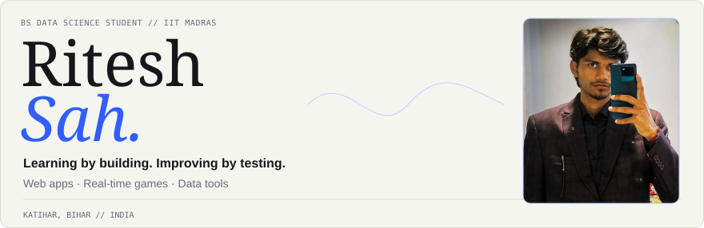
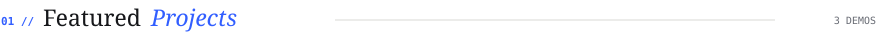
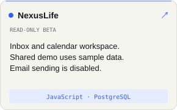
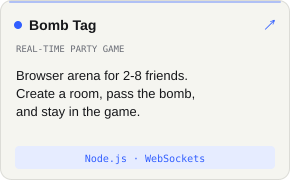
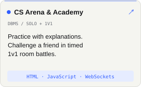
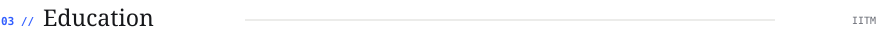

<picture><source media="(max-width: 600px)" srcset="./cards/21-hero-mobile.svg" /></picture> 
<a href="https://github.com/riteshsah235"><picture><source media="(max-width: 600px)" srcset="./cards/4-nav-github-mobile.svg" /></picture></a><a href="https://www.linkedin.com/in/ritesh-sah-0901a62a1/"><picture><source media="(max-width: 600px)" srcset="./cards/6-nav-linkedin-mobile.svg" /></picture></a><a href="mailto:riteshsah235@gmail.com"><picture><source media="(max-width: 600px)" srcset="./cards/8-nav-email-mobile.svg" /></picture></a>

<picture><source media="(prefers-color-scheme: dark) and (max-width: 600px)" srcset="./1-layout-1-h01-dark.svg" /><source media="(prefers-color-scheme: dark)" srcset="./13-layout-2-h02-dark.svg" /><source media="(max-width: 600px)" srcset="./3-layout-10-title-projects-mobile.svg" /></picture>

- **[NexusLife](https://nexuslife-dg8a.onrender.com/)**: Inbox and calendar workspace. Shared demo uses sample data. Email sending is disabled.
- **[Bomb Tag](https://bomb-tag-arena.onrender.com/)**: Browser arena for 2-8 friends. Create a room, pass the bomb, and stay in the game.
- **[CS Arena & Academy](https://cs-arena-kz30.onrender.com/)**: Practice with explanations. Challenge a friend in timed 1v1 room battles.

Early projects. Source repositories stay private. Free-hosted demos may take a moment to wake up.

<picture><source media="(prefers-color-scheme: dark) and (max-width: 600px)" srcset="./3-h03-dark.svg" /><source media="(prefers-color-scheme: dark)" srcset="./4-h04-dark.svg" /><source media="(max-width: 600px)" srcset="./11-title-experience-mobile.svg" /></picture>

**Summer Research Intern · Malaviya National Institute of Technology Jaipur**  
Jun-Jul 2025 · Jaipur, India

Worked on Digital Twin frameworks for urban mobility and planning with Dr. Nand Kumar and Prof. Ramesh Babu Battula. Applied spatial analytics and simulation to urban scenarios as part of an AMRUT-funded Smart City initiative.

<picture><source media="(prefers-color-scheme: dark) and (max-width: 600px)" srcset="./5-h05-dark.svg" /><source media="(prefers-color-scheme: dark)" srcset="./6-h06-dark.svg" /><source media="(max-width: 600px)" srcset="./4-title-education-mobile.svg" /></picture>

**BS in Data Science · Indian Institute of Technology Madras**  
Student, diploma level.

<picture><source media="(prefers-color-scheme: dark) and (max-width: 600px)" srcset="./14-layout-7-h07-dark.svg" /><source media="(prefers-color-scheme: dark)" srcset="./4-layout-8-h08-dark.svg" /><source media="(max-width: 600px)" srcset="./7-layout-6-14-title-archive-mobile.svg" /></picture>

| Project | What it covers | Access |
| :-- | :-- | :-- |
| **Rail Saarthi** | Railway complaint categorization, severity tagging and recurring-issue clustering. Sample-data ML demo. | [Source](https://github.com/riteshsah235/Rail_Saarthi) |
| **A2A Invoice Agent** | FastAPI invoice-decision project with evidence references, approval continuations and idempotent task handling. | [Source](https://github.com/riteshsah235/a2a-invoice-agent) |
| **GA5 Q2 Workbench** | Q2 browser-based embedding comparison from an uploaded dataset. Local computation; no portal submission or grade guarantee. | [Demo](https://ga5-dataset-workbench.vercel.app/) |
| **eShopCo Latency API** | Regional telemetry summaries: average and p95 latency, uptime and threshold breaches. Python on Vercel. | [Source](https://github.com/riteshsah235/eshopco-latency) |
| **Sentiment Analysis API** | Rule-based happy, sad and neutral labels using words, phrases and negation handling. FastAPI, not a trained language model. | [Source](https://github.com/riteshsah235/Sentiment-Analysis) |
| **TDS GitHub Action** | Coursework repository for GitHub Actions. | [Source](https://github.com/riteshsah235/tds-github-action) |

<picture><source media="(prefers-color-scheme: dark) and (max-width: 600px)" srcset="./11-layout-9-h09-dark.svg" /><source media="(prefers-color-scheme: dark)" srcset="./5-layout-10-h10-dark.svg" /><source media="(max-width: 600px)" srcset="./12-layout-8-16-title-toolkit-mobile.svg" /></picture>

| Area | Tools used in projects and study |
| :-- | :-- |
| Code | Python · JavaScript · SQL · Java |
| Web | HTML · CSS · Node.js · Express · FastAPI |
| Data & ML | Pandas · NumPy · Matplotlib · scikit-learn · TF-IDF · KMeans |
| Systems | PostgreSQL · WebSockets · Git · GitHub Actions |
| Hosting | Render · Vercel |

<picture><source media="(prefers-color-scheme: dark) and (max-width: 600px)" srcset="./8-layout-11-h11-dark.svg" /><source media="(prefers-color-scheme: dark)" srcset="./15-layout-12-h12-dark.svg" /><source media="(max-width: 600px)" srcset="./10-layout-10-18-title-connect-mobile.svg" /></picture>

<a href="https://github.com/riteshsah235"><b>GitHub</b></a> · <a href="https://www.linkedin.com/in/ritesh-sah-0901a62a1/"><b>LinkedIn</b></a> · <a href="mailto:riteshsah235@gmail.com"><b>Email</b></a> 

LEARNING THE FUNDAMENTALS. BUILDING THINGS THAT WORK.

